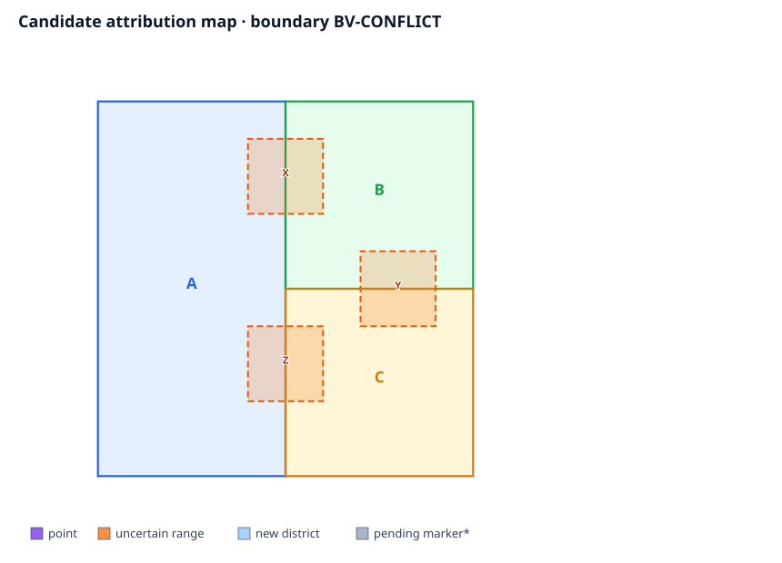

# 区划换版地址候选与可证计数报告（BV-CONFLICT）

- 状态：**infeasible**
- 参与精确分配地址：3
- 待核地址（不进入任何已证总量）：0
- 输入摘要：`7d66b8daaaaa65a94e46e8db9a87c476941486e40c1dac27546489b01b5c4498`
- 几何摘要：`2931efcad5f2be596691ec7007deb965cace5115d303e8814b3786cb8009b630`
- 控制摘要：`1f0c460afe25fbef06a80d9d17566dc18d1c2f2bdc95e9d8069aabd0764e9159`
- 辖区覆盖审计：未审计（未提供辖区范围）
- 原发布版：只读，未改写；本报告是新的重述产物。
- 小地图：[`conflict-map.svg`](./conflict-map.svg)



## 1. 地址候选归属

| 地址 | 状态 | 候选新区 | 来源/裁定 | 证据 |
|---|---|---|---|---|
| `X_AB` | eligible | `A`, `B` | `positive_area_intersection` | ；相交面积 {"A": 2.0, "B": 2.0} |
| `Y_BC` | eligible | `B`, `C` | `positive_area_intersection` | ；相交面积 {"B": 2.0, "C": 2.0} |
| `Z_AC` | eligible | `A`, `C` | `positive_area_intersection` | ；相交面积 {"A": 2.0, "C": 2.0} |

## 2. 交叉控制（同版绑定）

> Each control.total is enforced on eligible participating addresses only. pending_review addresses are excluded from proven counts and witnesses.

| 控制 | 成员新区集合 | 可信总量 |
|---|---|---:|
| `K_AB_eq_2` | `A`, `B` | 2 |
| `K_BC_eq_1` | `B`, `C` | 1 |
| `K_AC_eq_2` | `A`, `C` | 2 |

## 3. 辖区覆盖审计

- 未提供该边界版的辖区范围（`jurisdiction`），本次未做覆盖审计。
- 在输入中为该边界版提供 `jurisdiction` 几何即可启用覆盖闸门。

## 4. 整体无解：可复核冲突

- 求解器结论：`initial propagation conflict`
- 最小冲突控制核：`K_AB_eq_2`, `K_BC_eq_1`, `K_AC_eq_2`
- 以下每个真子集均存在完整分配见证；这说明不是单个控制或单个区界的局部问题。

### 去掉 `K_AB_eq_2` 后可行

剩余控制：["K_BC_eq_1", "K_AC_eq_2"]

```json
{"X_AB": "A", "Y_BC": "B", "Z_AC": "A"}
```
### 去掉 `K_BC_eq_1` 后可行

剩余控制：["K_AB_eq_2", "K_AC_eq_2"]

```json
{"X_AB": "A", "Y_BC": "B", "Z_AC": "C"}
```
### 去掉 `K_AC_eq_2` 后可行

剩余控制：["K_AB_eq_2", "K_BC_eq_1"]

```json
{"X_AB": "A", "Y_BC": "C", "Z_AC": "A"}
```
### 全量原始候选组合复核

候选笛卡尔积共 **8** 份，以下逐份检查：

| # | 分配 | 各区计数 | 控制实测 | 全满足 |
|---:|---|---|---|---|
| 1 | `{"X_AB": "A", "Y_BC": "B", "Z_AC": "A"}` | `{"A": 2, "B": 1, "C": 0}` | K_AB_eq_2=3/2✗; K_BC_eq_1=1/1✓; K_AC_eq_2=2/2✓ | 否 |
| 2 | `{"X_AB": "A", "Y_BC": "B", "Z_AC": "C"}` | `{"A": 1, "B": 1, "C": 1}` | K_AB_eq_2=2/2✓; K_BC_eq_1=2/1✗; K_AC_eq_2=2/2✓ | 否 |
| 3 | `{"X_AB": "A", "Y_BC": "C", "Z_AC": "A"}` | `{"A": 2, "B": 0, "C": 1}` | K_AB_eq_2=2/2✓; K_BC_eq_1=1/1✓; K_AC_eq_2=3/2✗ | 否 |
| 4 | `{"X_AB": "A", "Y_BC": "C", "Z_AC": "C"}` | `{"A": 1, "B": 0, "C": 2}` | K_AB_eq_2=1/2✗; K_BC_eq_1=2/1✗; K_AC_eq_2=3/2✗ | 否 |
| 5 | `{"X_AB": "B", "Y_BC": "B", "Z_AC": "A"}` | `{"A": 1, "B": 2, "C": 0}` | K_AB_eq_2=3/2✗; K_BC_eq_1=2/1✗; K_AC_eq_2=1/2✗ | 否 |
| 6 | `{"X_AB": "B", "Y_BC": "B", "Z_AC": "C"}` | `{"A": 0, "B": 2, "C": 1}` | K_AB_eq_2=2/2✓; K_BC_eq_1=3/1✗; K_AC_eq_2=1/2✗ | 否 |
| 7 | `{"X_AB": "B", "Y_BC": "C", "Z_AC": "A"}` | `{"A": 1, "B": 1, "C": 1}` | K_AB_eq_2=2/2✓; K_BC_eq_1=2/1✗; K_AC_eq_2=2/2✓ | 否 |
| 8 | `{"X_AB": "B", "Y_BC": "C", "Z_AC": "C"}` | `{"A": 0, "B": 1, "C": 2}` | K_AB_eq_2=1/2✗; K_BC_eq_1=3/1✗; K_AC_eq_2=2/2✓ | 否 |

/usr/bin/python3 -I /workspace/redistrict/cli.py verify --input /workspace/examples/local_global_conflict.json --result /workspace/outputs/conflict-result.json

**未输出任何区计数上下界或见证，避免制造假计数。**
