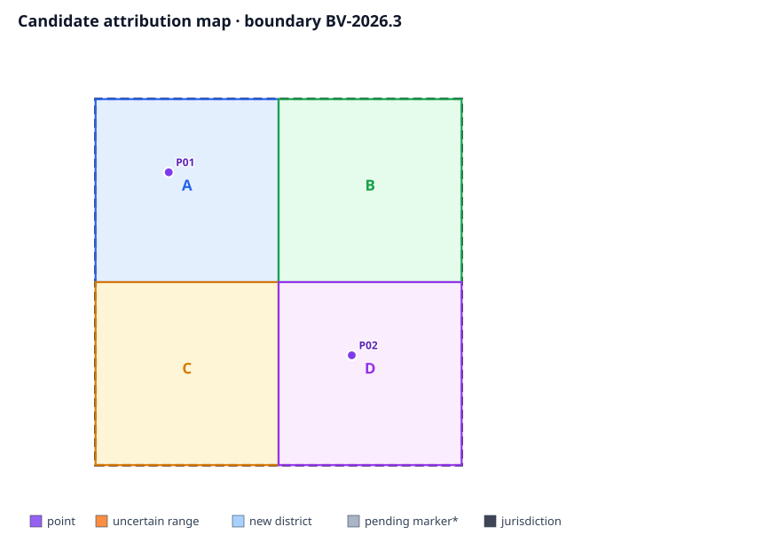

# 区划换版地址候选与可证计数报告（BV-2026.3）

- 状态：**feasible**
- 参与精确分配地址：3
- 待核地址（不进入任何已证总量）：0
- 输入摘要：`daff2e5f9d0f064372c1ffacd1f209c1ac7635486ed38ff04ad47cefc398b6fb`
- 几何摘要：`1b3439ad0d050adc0b2e8d2d8e52836201aa355996f5707060d5b71863f54a8c`
- 控制摘要：`b3af39482d265ca20bc8dc45f56e52690c055c70ca92647059e87fb5805a1fbc`
- 辖区覆盖审计：完整覆盖
- 原发布版：`PUB-2020-OLD`（只读，SHA-256 `f177ce52ae8afee11587fa8e9aab38f1dac300f1628f1e0afe67cc5bf164ec8c`）；本报告是新的重述产物。
- 小地图：[`coverage-complete-map.svg`](./coverage-complete-map.svg)



## 1. 地址候选归属

| 地址 | 状态 | 候选新区 | 来源/裁定 | 证据 |
|---|---|---|---|---|
| `P01_in_A` | eligible | `A` | `point_interior_containment` | strict interior |
| `P02_in_D` | eligible | `D` | `point_interior_containment` | strict interior |
| `M03_explicit_BC` | eligible | `B`, `C` | `explicit_missing_location` |  |

## 2. 交叉控制（同版绑定）

> Each control.total is enforced on eligible participating addresses only. pending_review addresses are excluded from proven counts and witnesses.

| 控制 | 成员新区集合 | 可信总量 |
|---|---|---:|
| `K_BC_1` | `B`, `C` | 1 |

## 3. 辖区覆盖审计

- 辖区：`JUR-DEMO-3`（边界版 `BV-2026.3`）
- 辖区面积：100.0
- 新区覆盖面积：100.0（覆盖率 1.0）
- **未覆盖面积：0.0**（正面积阈值 1e-09）
- 面积交叉复核：未覆盖几何面积 0.0 vs 辖区−覆盖 0.0，差 0.0（容差 1.01e-07）→ 通过
- 结论：**覆盖完整**；现有地址归属与计数结果不受影响。

## 4. 各新区可证计数上下界及全局见证

> 上下界来自对全部合法分配的精确优化。每个界都附完整分配；不得把不同区的独立极值自行拼接。

| 新区 | 下界 | 上界 | 确定计数 | 下界见证 | 上界见证 |
|---|---:|---:|---|---|---|
| `A` | **1** | **1** | 是 | `witness:A:lower` | `witness:A:upper` |
| `B` | **0** | **1** | 否 | `witness:B:lower` | `witness:B:upper` |
| `C` | **0** | **1** | 否 | `witness:C:lower` | `witness:C:upper` |
| `D` | **1** | **1** | 是 | `witness:D:lower` | `witness:D:upper` |

### `A` 下界 1 见证

```json
{"M03_explicit_BC": "B", "P01_in_A": "A", "P02_in_D": "D"}
```
控制复核：`[{"control_id": "K_BC_1", "expected": 1, "observed": 1, "satisfied": true}]`

### `A` 上界 1 见证

```json
{"M03_explicit_BC": "B", "P01_in_A": "A", "P02_in_D": "D"}
```
控制复核：`[{"control_id": "K_BC_1", "expected": 1, "observed": 1, "satisfied": true}]`

### `B` 下界 0 见证

```json
{"M03_explicit_BC": "C", "P01_in_A": "A", "P02_in_D": "D"}
```
控制复核：`[{"control_id": "K_BC_1", "expected": 1, "observed": 1, "satisfied": true}]`

### `B` 上界 1 见证

```json
{"M03_explicit_BC": "B", "P01_in_A": "A", "P02_in_D": "D"}
```
控制复核：`[{"control_id": "K_BC_1", "expected": 1, "observed": 1, "satisfied": true}]`

### `C` 下界 0 见证

```json
{"M03_explicit_BC": "B", "P01_in_A": "A", "P02_in_D": "D"}
```
控制复核：`[{"control_id": "K_BC_1", "expected": 1, "observed": 1, "satisfied": true}]`

### `C` 上界 1 见证

```json
{"M03_explicit_BC": "C", "P01_in_A": "A", "P02_in_D": "D"}
```
控制复核：`[{"control_id": "K_BC_1", "expected": 1, "observed": 1, "satisfied": true}]`

### `D` 下界 1 见证

```json
{"M03_explicit_BC": "B", "P01_in_A": "A", "P02_in_D": "D"}
```
控制复核：`[{"control_id": "K_BC_1", "expected": 1, "observed": 1, "satisfied": true}]`

### `D` 上界 1 见证

```json
{"M03_explicit_BC": "B", "P01_in_A": "A", "P02_in_D": "D"}
```
控制复核：`[{"control_id": "K_BC_1", "expected": 1, "observed": 1, "satisfied": true}]`

### 极值不得自行拼接的联合检查

District extrema are proven separately. A stitched vector is accepted only if this joint solver check returns a complete witness; otherwise it is not a legal assignment.

- 所有区下界直接拼接 `{"A": 1, "B": 0, "C": 0, "D": 1}`：**不是合法分配（拒收该拼接）**
- 所有区上界直接拼接 `{"A": 1, "B": 1, "C": 1, "D": 1}`：**不是合法分配（拒收该拼接）**

## 5. 地址级确定性

只有在所有合法分配中候选新区唯一时才写作“确定”。

| 地址 | 几何候选 | 控制约束后所有可能去向 | 结论 | 确定区 |
|---|---|---|---|---|
| `P01_in_A` | `A` | `A` | deterministic | `A` |
| `P02_in_D` | `D` | `D` | deterministic | `D` |
| `M03_explicit_BC` | `B`, `C` | `B`, `C` | ambiguous | — |

## 6. 与原发布版/可比发布数的重述差异

差异字段同时给出两个方向，避免符号歧义。

| 对象 | 原发布数 | 可证下界 | 可证上界 | 重述-发布(下边/上边) | 发布-重述(下界/上界) | 原值全局可行 |
|---|---:|---:|---:|---:|---:|---|
| `PUB_A_2020` | 1 | 1 | 1 | +0 / +0 | +0 / +0 | 是（有见证） |

## 7. “平均摊”诊断（非证明计数）

Fractional averaging is not used for proven bounds and must not be published as an address count.

| 新区 | 等额均分等效值 | 按正面积加权等效值 | 可证区间 |
|---|---:|---:|---|
| `A` | 1.000 | 1.000 | [1, 1] |
| `B` | 0.500 | 0.500 | [0, 1] |
| `C` | 0.500 | 0.500 | [0, 1] |
| `D` | 1.000 | 1.000 | [1, 1] |

## 8. 独立复核

```bash
/usr/bin/python3 -I /workspace/redistrict/cli.py verify --input /workspace/examples/coverage_complete_demo.json --result /workspace/outputs/coverage-complete-result.json --published /workspace/examples/published_release_2020.json
```
