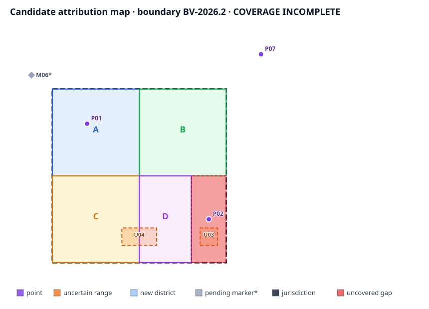

# 区划换版地址候选与可证计数报告（BV-2026.2）

- 状态：**coverage_incomplete**
- 参与精确分配地址：3
- 待核地址（不进入任何已证总量）：4
- 输入摘要：`00f1aa7e1e0d6e821f86f0a5e078f44ec3355f1f29e46c44fa420997c2c57e5d`
- 几何摘要：`f2dde9d440baf02a6b361043e23cea336896fd23e75a3be3af967c3e0ef12525`
- 控制摘要：`affb19d012c2a890bb163e16f192fbd21d3334145f8522812a4d59a4998d0aca`
- 辖区覆盖审计：**覆盖不完整**
- 原发布版：`PUB-2020-OLD`（只读，SHA-256 `f177ce52ae8afee11587fa8e9aab38f1dac300f1628f1e0afe67cc5bf164ec8c`）；本报告是新的重述产物。
- 小地图：[`coverage-gap-map.svg`](./coverage-gap-map.svg)



## 1. 地址候选归属

| 地址 | 状态 | 候选新区 | 来源/裁定 | 证据 |
|---|---|---|---|---|
| `P01_in_A` | eligible | `A` | `point_interior_containment` | strict interior |
| `P02_in_gap` | pending_review | — | `point_no_containment_or_touch` | inside_uncovered_jurisdiction_area（原判定：point_outside_or_not_touching_any_district） |
| `U03_range_gap` | pending_review | — | `positive_area_intersection` | overlaps_uncovered_jurisdiction_area（原判定：no_positive_area_intersection）；未覆盖重叠面积 1.0 |
| `U04_range_CD` | eligible | `C`, `D` | `positive_area_intersection` | ；相交面积 {"C": 1.0, "D": 1.0} |
| `M05_explicit_AB` | eligible | `A`, `B` | `explicit_missing_location` |  |
| `M06_missing_pending` | pending_review | — | `` | missing_location_without_explicit_candidate_set |
| `P07_outside_jurisdiction` | pending_review | — | `point_no_containment_or_touch` | point outside all target districts |

### 待核清单

- `P02_in_gap`：inside_uncovered_jurisdiction_area
- `U03_range_gap`：overlaps_uncovered_jurisdiction_area
- `M06_missing_pending`：missing_location_without_explicit_candidate_set
- `P07_outside_jurisdiction`：point_outside_or_not_touching_any_district

## 2. 交叉控制（同版绑定）

> Each control.total is enforced on eligible participating addresses only. pending_review addresses are excluded from proven counts and witnesses.

| 控制 | 成员新区集合 | 可信总量 |
|---|---|---:|
| `K_AB_2` | `A`, `B` | 2 |
| `K_CD_1` | `C`, `D` | 1 |

## 3. 辖区覆盖审计

- 辖区：`JUR-DEMO-2`（边界版 `BV-2026.2`）
- 辖区面积：100.0
- 新区覆盖面积：90.0（覆盖率 0.9）
- **未覆盖面积：10.0**（正面积阈值 1e-09）
- 面积交叉复核：未覆盖几何面积 10.0 vs 辖区−覆盖 10.0，差 0.0（容差 1.01e-07）→ 通过
- 结论：**覆盖不完整**：辖区内存在 1 块未覆盖区域，几何如下（水平条带精确分解，各部分仅共边）：

```json
{"coordinates": [[[[8.0, 0.0], [10.0, 0.0], [10.0, 5.0], [8.0, 5.0], [8.0, 0.0]]]], "type": "MultiPolygon"}
```

## 4. 发布闸门：可证计数与重述结论已暂扣

辖区覆盖不完整，本版**不得发布**以下内容，本次运行也未生成：

- `count_bounds`
- `witnesses`
- `joint_extrema_check`
- `determinations`
- `restatement_differences`
- `naive_average_diagnostic`

以下待核地址落在辖区内未覆盖区域，属于**边界覆盖缺口**，不得当作地址缺失：

- `P02_in_gap`
- `U03_range_gap`

修复新区边界使其完整覆盖辖区后重新运行；原发布版数据只读，未被修改。

## 5. 独立复核

```bash
/usr/bin/python3 -I /workspace/redistrict/cli.py verify --input /workspace/examples/coverage_gap_demo.json --result /workspace/outputs/coverage-gap-result.json --published /workspace/examples/published_release_2020.json
```
