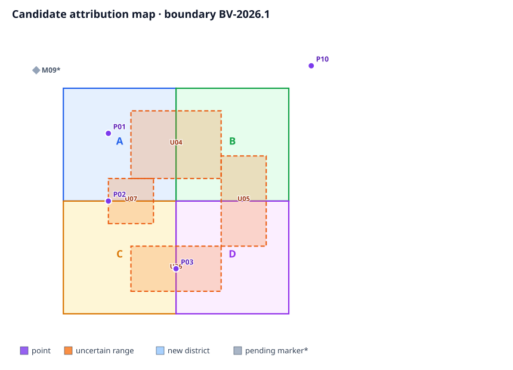

# 区划换版地址候选与可证计数报告（BV-2026.1）

- 状态：**feasible**
- 参与精确分配地址：8
- 待核地址（不进入任何已证总量）：2
- 输入摘要：`1abec2d6aab16631fa635d80d9fd3ef1857ec760237e3b52d2c2af9933d52fc0`
- 几何摘要：`ebdd6c634d1d6f21f4c424b9429f4ac8a9c605b22d443d3c01c532ee9cfb1dbd`
- 控制摘要：`e5c20497760fe2860ed1082cd03747737a2347fbba95d2bc9d74ef179ccf5ac3`
- 原发布版：`PUB-2020-OLD`（只读，SHA-256 `f177ce52ae8afee11587fa8e9aab38f1dac300f1628f1e0afe67cc5bf164ec8c`）；本报告是新的重述产物。
- 小地图：[`cross-map.svg`](./cross-map.svg)



## 1. 地址候选归属

| 地址 | 状态 | 候选新区 | 来源/裁定 | 证据 |
|---|---|---|---|---|
| `P01_A_interior` | eligible | `A` | `point_interior_containment` | strict interior |
| `P02_AC_boundary_priority` | eligible | `A` | `shared_boundary_priority` | priority winner A |
| `P03_CD_boundary_tie` | eligible | `C`, `D` | `shared_boundary_all_touch` | priority tie; all touching districts retained |
| `U04_AB_range` | eligible | `A`, `B` | `positive_area_intersection` | ；相交面积 {"A": 6.0, "B": 6.0} |
| `U05_BD_range` | eligible | `B`, `D` | `positive_area_intersection` | ；相交面积 {"B": 4.0, "D": 4.0} |
| `U06_CD_range` | eligible | `C`, `D` | `positive_area_intersection` | ；相交面积 {"C": 4.0, "D": 4.0} |
| `U07_AC_range` | eligible | `A`, `C` | `positive_area_intersection` | ；相交面积 {"A": 2.0, "C": 2.0} |
| `M08_explicit_BC` | eligible | `B`, `C` | `explicit_missing_location` |  |
| `M09_missing_pending` | pending_review | — | `` | missing_location_without_explicit_candidate_set |
| `P10_outside_pending` | pending_review | — | `point_no_containment_or_touch` | point outside all target districts |

### 待核清单

- `M09_missing_pending`：missing_location_without_explicit_candidate_set
- `P10_outside_pending`：point_outside_or_not_touching_any_district

## 2. 交叉控制（同版绑定）

> Each control.total is enforced on eligible participating addresses only. pending_review addresses are excluded from proven counts and witnesses.

| 控制 | 成员新区集合 | 可信总量 |
|---|---|---:|
| `K_AB_5` | `A`, `B` | 5 |
| `K_BC_4` | `B`, `C` | 4 |
| `K_CD_3` | `C`, `D` | 3 |

## 3. 各新区可证计数上下界及全局见证

> 上下界来自对全部合法分配的精确优化。每个界都附完整分配；不得把不同区的独立极值自行拼接。

| 新区 | 下界 | 上界 | 确定计数 | 下界见证 | 上界见证 |
|---|---:|---:|---|---|---|
| `A` | **2** | **4** | 否 | `witness:A:lower` | `witness:A:upper` |
| `B` | **1** | **3** | 否 | `witness:B:lower` | `witness:B:upper` |
| `C` | **1** | **3** | 否 | `witness:C:lower` | `witness:C:upper` |
| `D` | **0** | **2** | 否 | `witness:D:lower` | `witness:D:upper` |

### `A` 下界 2 见证

```json
{"M08_explicit_BC": "B", "P01_A_interior": "A", "P02_AC_boundary_priority": "A", "P03_CD_boundary_tie": "D", "U04_AB_range": "B", "U05_BD_range": "B", "U06_CD_range": "D", "U07_AC_range": "C"}
```
控制复核：`[{"control_id": "K_AB_5", "expected": 5, "observed": 5, "satisfied": true}, {"control_id": "K_BC_4", "expected": 4, "observed": 4, "satisfied": true}, {"control_id": "K_CD_3", "expected": 3, "observed": 3, "satisfied": true}]`

### `A` 上界 4 见证

```json
{"M08_explicit_BC": "C", "P01_A_interior": "A", "P02_AC_boundary_priority": "A", "P03_CD_boundary_tie": "C", "U04_AB_range": "A", "U05_BD_range": "B", "U06_CD_range": "C", "U07_AC_range": "A"}
```
控制复核：`[{"control_id": "K_AB_5", "expected": 5, "observed": 5, "satisfied": true}, {"control_id": "K_BC_4", "expected": 4, "observed": 4, "satisfied": true}, {"control_id": "K_CD_3", "expected": 3, "observed": 3, "satisfied": true}]`

### `B` 下界 1 见证

```json
{"M08_explicit_BC": "C", "P01_A_interior": "A", "P02_AC_boundary_priority": "A", "P03_CD_boundary_tie": "C", "U04_AB_range": "A", "U05_BD_range": "B", "U06_CD_range": "C", "U07_AC_range": "A"}
```
控制复核：`[{"control_id": "K_AB_5", "expected": 5, "observed": 5, "satisfied": true}, {"control_id": "K_BC_4", "expected": 4, "observed": 4, "satisfied": true}, {"control_id": "K_CD_3", "expected": 3, "observed": 3, "satisfied": true}]`

### `B` 上界 3 见证

```json
{"M08_explicit_BC": "B", "P01_A_interior": "A", "P02_AC_boundary_priority": "A", "P03_CD_boundary_tie": "D", "U04_AB_range": "B", "U05_BD_range": "B", "U06_CD_range": "D", "U07_AC_range": "C"}
```
控制复核：`[{"control_id": "K_AB_5", "expected": 5, "observed": 5, "satisfied": true}, {"control_id": "K_BC_4", "expected": 4, "observed": 4, "satisfied": true}, {"control_id": "K_CD_3", "expected": 3, "observed": 3, "satisfied": true}]`

### `C` 下界 1 见证

```json
{"M08_explicit_BC": "B", "P01_A_interior": "A", "P02_AC_boundary_priority": "A", "P03_CD_boundary_tie": "D", "U04_AB_range": "B", "U05_BD_range": "B", "U06_CD_range": "D", "U07_AC_range": "C"}
```
控制复核：`[{"control_id": "K_AB_5", "expected": 5, "observed": 5, "satisfied": true}, {"control_id": "K_BC_4", "expected": 4, "observed": 4, "satisfied": true}, {"control_id": "K_CD_3", "expected": 3, "observed": 3, "satisfied": true}]`

### `C` 上界 3 见证

```json
{"M08_explicit_BC": "C", "P01_A_interior": "A", "P02_AC_boundary_priority": "A", "P03_CD_boundary_tie": "C", "U04_AB_range": "A", "U05_BD_range": "B", "U06_CD_range": "C", "U07_AC_range": "A"}
```
控制复核：`[{"control_id": "K_AB_5", "expected": 5, "observed": 5, "satisfied": true}, {"control_id": "K_BC_4", "expected": 4, "observed": 4, "satisfied": true}, {"control_id": "K_CD_3", "expected": 3, "observed": 3, "satisfied": true}]`

### `D` 下界 0 见证

```json
{"M08_explicit_BC": "C", "P01_A_interior": "A", "P02_AC_boundary_priority": "A", "P03_CD_boundary_tie": "C", "U04_AB_range": "A", "U05_BD_range": "B", "U06_CD_range": "C", "U07_AC_range": "A"}
```
控制复核：`[{"control_id": "K_AB_5", "expected": 5, "observed": 5, "satisfied": true}, {"control_id": "K_BC_4", "expected": 4, "observed": 4, "satisfied": true}, {"control_id": "K_CD_3", "expected": 3, "observed": 3, "satisfied": true}]`

### `D` 上界 2 见证

```json
{"M08_explicit_BC": "B", "P01_A_interior": "A", "P02_AC_boundary_priority": "A", "P03_CD_boundary_tie": "D", "U04_AB_range": "B", "U05_BD_range": "B", "U06_CD_range": "D", "U07_AC_range": "C"}
```
控制复核：`[{"control_id": "K_AB_5", "expected": 5, "observed": 5, "satisfied": true}, {"control_id": "K_BC_4", "expected": 4, "observed": 4, "satisfied": true}, {"control_id": "K_CD_3", "expected": 3, "observed": 3, "satisfied": true}]`

### 极值不得自行拼接的联合检查

District extrema are proven separately. A stitched vector is accepted only if this joint solver check returns a complete witness; otherwise it is not a legal assignment.

- 所有区下界直接拼接 `{"A": 2, "B": 1, "C": 1, "D": 0}`：**不是合法分配（拒收该拼接）**
- 所有区上界直接拼接 `{"A": 4, "B": 3, "C": 3, "D": 2}`：**不是合法分配（拒收该拼接）**

## 4. 地址级确定性

只有在所有合法分配中候选新区唯一时才写作“确定”。

| 地址 | 几何候选 | 控制约束后所有可能去向 | 结论 | 确定区 |
|---|---|---|---|---|
| `P01_A_interior` | `A` | `A` | deterministic | `A` |
| `P02_AC_boundary_priority` | `A` | `A` | deterministic | `A` |
| `P03_CD_boundary_tie` | `C`, `D` | `C`, `D` | ambiguous | — |
| `U04_AB_range` | `A`, `B` | `A`, `B` | ambiguous | — |
| `U05_BD_range` | `B`, `D` | `B`, `D` | ambiguous | — |
| `U06_CD_range` | `C`, `D` | `C`, `D` | ambiguous | — |
| `U07_AC_range` | `A`, `C` | `A`, `C` | ambiguous | — |
| `M08_explicit_BC` | `B`, `C` | `B`, `C` | ambiguous | — |

## 5. 与原发布版/可比发布数的重述差异

差异字段同时给出两个方向，避免符号歧义。

| 对象 | 原发布数 | 可证下界 | 可证上界 | 重述-发布(下边/上边) | 发布-重述(下界/上界) | 原值全局可行 |
|---|---:|---:|---:|---:|---:|---|
| `PUB_A_2020` | 3 | 2 | 4 | -1 / +1 | +1 / -1 | 是（有见证） |
| `PUB_NORTH_AB` | 5 | 5 | 5 | +0 / +0 | +0 / +0 | 是（有见证） |

## 6. “平均摊”诊断（非证明计数）

Fractional averaging is not used for proven bounds and must not be published as an address count.

| 新区 | 等额均分等效值 | 按正面积加权等效值 | 可证区间 |
|---|---:|---:|---|
| `A` | 3.000 | 3.000 | [2, 4] |
| `B` | 1.500 | 1.500 | [1, 3] |
| `C` | 2.000 | 2.000 | [1, 3] |
| `D` | 1.500 | 1.500 | [0, 2] |

## 7. 独立复核

```bash
/usr/bin/python3 -I /workspace/redistrict/cli.py verify --input /workspace/examples/cross_controls_demo.json --result /workspace/outputs/cross-result.json --published /workspace/examples/published_release_2020.json
```
